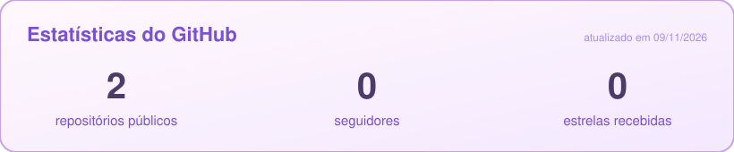

  

# Olá, eu sou a Sarah 👋

### Estudante de Ciência da Computação no Mackenzie 💜

*Gosto de entender como os sistemas funcionam por dentro e de explicar isso com clareza.*

**Navegação:** [Sobre](#-sobre-mim) · [Projetos](#-projetos-em-destaque) · [Tecnologias](#-tecnologias-e-ferramentas) · [Trajetória](#-trajetória) · [Acadêmicos](#-outros-projetos-acadêmicos) · [Estatísticas](#-estatísticas-do-github) · [Contatos](#-contatos)

---

## 🌸 Sobre mim

Estudo **Ciência da Computação** no **Mackenzie** e sou **monitora de Matemática Discreta I**. Programo em C, Python, Java e Swift, e meu projeto mais recente reproduz um deadlock de forma controlada em um simulador multithread.

Também fiz os cursos de iOS e Design da **Apple Developer Academy**, participei de um programa de tecnologia no **Technion**, em Israel, e mantenho um canal no YouTube desde 2021.

🎯 **Procuro estágio em tecnologia** em São Paulo, 30h semanais, a partir de janeiro de 2027.

---

## 🚀 Projetos em destaque

### ⚙️ Simulador multithread (Sistemas Operacionais)

Projeto em grupo da disciplina **Sistemas Operacionais** (2026.2): produtores e consumidores sobre um buffer de capacidade limitada, disputando dois tipos de recurso escasso.

- **Reprodução controlada de deadlock**, com evidência em log de eventos conferida por script em Python
- Sincronização com **mutex e variáveis de condição**
- **Encerramento ordenado** de todas as threads

**Ferramentas:** C · pthreads · Make · Python

---

### 📚 Lê Vou

Aplicativo de **troca e venda de livros**, com interface desenvolvida no **Figma** durante a **Apple Developer Academy**.

  

**Telas:** Início · Recomendações · Detalhes do livro · Vendedor e condição · Catálogo · Livros à venda · Perfil do usuário · Cadastro de livro

**Ferramentas:** Figma

---

### 🔴 Pokédex

App iOS desenvolvido durante o **Foundation iOS** para **registrar Pokémon capturados**, seus tipos e poderes.

**Ferramentas:** Swift

🔗 [Ver projeto no Google Drive](https://drive.google.com/file/d/1PGL12tzjmyUmx1MC1Ihqq9pp3wDArrVx/view?usp=drivesdk)

---

## 🧰 Tecnologias e ferramentas

---

## 🦋 Trajetória

- 🎓 **Ciência da Computação** · Universidade Presbiteriana Mackenzie · 2025 a 2028 (previsão)
- 🧑‍🏫 **Monitoria de Matemática Discreta I** · Mackenzie · desde agosto de 2026
- 🍎 **Apple Developer Academy** · Foundation iOS, Lógica de Programação e Design · 2025
- 🌍 **Programa Global de Tecnologia** · Technion, Israel · 2023
- 🎬 **[Canal no YouTube sobre futebol](https://www.youtube.com/@Gabi_no_Nubank_Parque)** · 2 mil inscritos · roteiro, edição e miniaturas
- 🗣️ **Idiomas:** português (nativo) e inglês (fluente)

---

## 💻 Outros projetos acadêmicos

### 🖼️ Codificador de Imagem Binária (C)

Programa em **C** que lê uma imagem binária no formato PBM (P1), por arquivo ou entrada manual, e a codifica com divisão recursiva: cada bloco vira `P` (todo preto), `B` (todo branco) ou `X` (misto, dividido em quatro partes). Trabalho em dupla.

---

### ☕ Torre de Hanoi (Java)

Jogo da Torre de Hanoi em **Java**, em que o usuário informa a quantidade de discos pelo terminal. Trabalho em grupo.

---

### 🚗 Simulador de multas de trânsito (Python)

Programa em **Python** que classifica a infração pela velocidade registrada (leve, grave ou gravíssima), calcula multa e pontos na CNH, aplica dobro em caso de reincidência e simula o desconto de 20% para pagamento imediato. Trabalho em grupo.

---

## 📊 Estatísticas do GitHub

Atualizado automaticamente todos os dias pelo GitHub Actions.

---

## 📫 Contatos

  

Obrigada por visitar meu perfil! ✨

