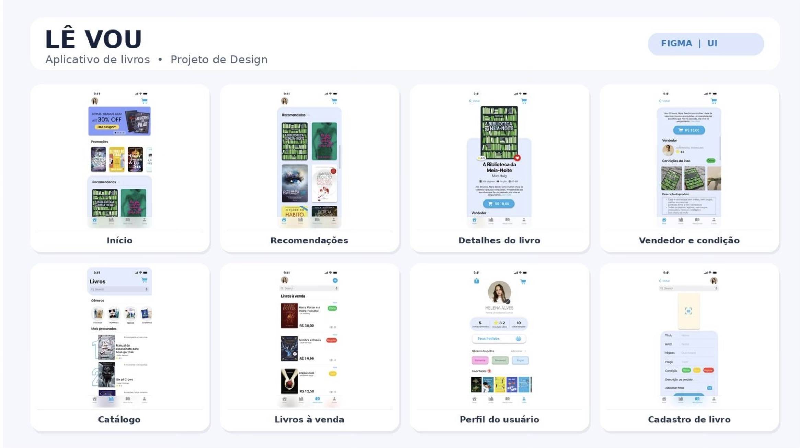

  

# Olá, eu sou a Sarah 👋

### Estudante de Ciência da Computação no Mackenzie 💜

*Buscando oportunidades de estágio em tecnologia, com abertura para diferentes áreas.*

**Navegação:** [Sobre](#-sobre-mim) · [Ficha](#-ficha) · [Jornada](#-minha-jornada-na-tecnologia) · [Tecnologias](#-tecnologias-e-ferramentas) · [Projetos](#-projetos-em-destaque) · [Formação](#-formação-acadêmica-e-monitoria) · [Estatísticas](#-estatísticas-do-github) · [Contatos](#-contatos)

---

## 🌸 Sobre mim

Sou estudante de **Ciência da Computação** no **Mackenzie**. Tenho interesse em tecnologia de forma ampla e busco oportunidades de estágio em diferentes áreas da computação.

Atuo também como **monitora de Matemática Discreta I**, o que me ajuda a organizar ideias com clareza e a explicar conceitos com paciência.

---

## 🪪 Ficha

- 🎓 **Curso:** Ciência da Computação
- 🏫 **Instituição:** Universidade Presbiteriana Mackenzie
- 🧑‍🏫 **Monitoria:** Matemática Discreta I
- 🎯 **Objetivo:** estágio em tecnologia, com abertura para diferentes áreas

---

## 🦋 Minha jornada na tecnologia

- **Projetos acadêmicos de programação e desenvolvimento** durante a graduação em Ciência da Computação.
- **Design de interfaces no Figma** durante a **Apple Academy**, com o projeto *Lê Vou*.
- **Desenvolvimento iOS** durante o **Foundation iOS**, com o projeto *Pokébola*.
- **Sistemas Operacionais e programação em C**, com um simulador multithread desenvolvido em grupo.
- **Monitoria de Matemática Discreta I** no Mackenzie.

---

## 🧰 Tecnologias e ferramentas

🌱 Swift em desenvolvimento.

---

## 🚀 Projetos em destaque

### 📚 Lê Vou

Aplicativo de **troca de livros**, com interface desenvolvida no **Figma** durante a **Apple Academy**.

  

**Telas:** Início · Recomendações · Detalhes do livro · Vendedor e condição · Catálogo · Livros à venda · Perfil do usuário · Cadastro de livro

**Ferramentas:** Figma

---

### 🔴 Pokébola

Projeto desenvolvido durante o **Foundation iOS** para **registrar Pokémon capturados**, seus tipos e poderes.

**Ferramentas:** Swift

🔗 [Ver projeto no Google Drive](https://drive.google.com/file/d/1PGL12tzjmyUmx1MC1Ihqq9pp3wDArrVx/view?usp=drivesdk)

---

### ⚙️ Simulador multithread (Sistemas Operacionais)

Projeto em grupo da disciplina **Sistemas Operacionais** (2026.2): produtores e consumidores sobre um buffer de capacidade limitada, disputando dois tipos de recurso escasso.

**Destaques:** mutex e variáveis de condição, encerramento ordenado e reprodução controlada de deadlock, com evidência em log de eventos.

**Ferramentas:** C · pthreads · Make · Python (verificação do log)

---

## 🎓 Formação acadêmica e monitoria

- 🎓 **Ciência da Computação** · Universidade Presbiteriana Mackenzie
- 🧑‍🏫 **Monitoria de Matemática Discreta I** · Mackenzie
- 🍎 **Apple Academy** · design de interfaces no Figma
- 📱 **Foundation iOS** · desenvolvimento iOS

---

## 📊 Estatísticas do GitHub

---

## 📫 Contatos

  

Obrigada por visitar meu perfil! ✨

